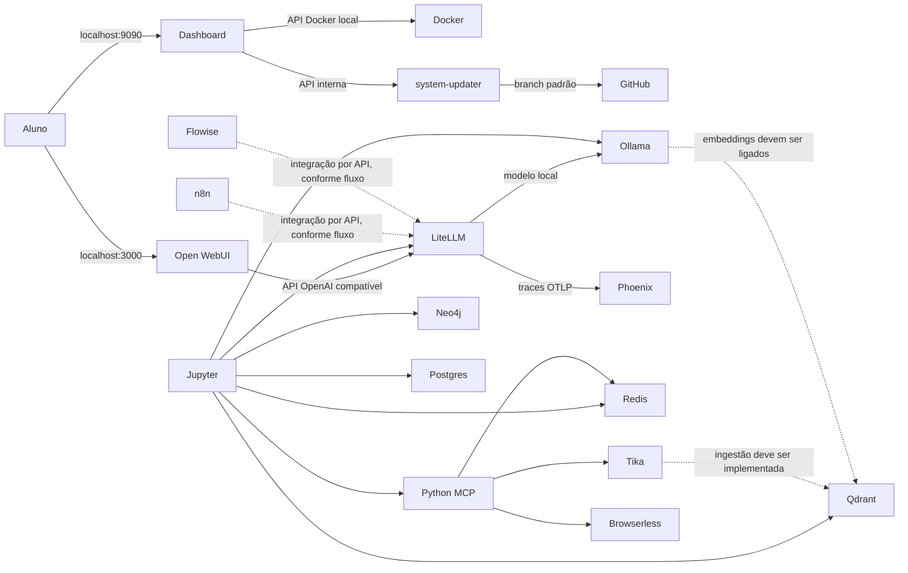

# Arquitetura atual do Laboratório de IA

Este documento descreve o estado implementado no repositório. Para instalar, siga o [README](../README.md). Para regras de manutenção por agentes, consulte [AGENTS.md](../AGENTS.md). A configuração executável em `docker-compose.yml` é a fonte de verdade para nomes, portas, volumes e perfis; confira-a antes de atualizar este texto.

## Propósito e execução

O laboratório é uma stack local para **uma instalação por aluno**. Pode rodar em Ubuntu nativo ou Ubuntu 24.04 sob WSL 2 no Windows. Docker Compose é usado nos dois modos. Uma GPU NVIDIA é opcional; a inferência continua disponível em CPU, com desempenho menor.

O Compose contém 19 serviços definidos: 17 de aprendizagem, um `system-updater` de suporte e Portainer no perfil administrativo `management`. Oito serviços de aprendizagem iniciam sem perfil; `full` acrescenta nove. Portanto, `--profile full` sobe 18 containers incluindo o atualizador; `--profile management` acrescenta Portainer. Veja portas e funções no [inventário do README](../README.md#serviços-e-portas).

## Componentes por função

| Camada | Serviços | Responsabilidade |
| --- | --- | --- |
| Acesso e controle | `dashboard`, `system-updater` | Página inicial, catálogo/estado de serviços, liga/desliga, documentação, arquitetura, reset, destino da Sala de Aula e atualização do código publicado. |
| Inferência e chat | `ollama`, `open-webui`, `litellm` | Servir modelos locais, interface de chat e gateway de APIs. Open WebUI está configurado para usar LiteLLM; uma conexão direta adicional com Ollama requer configuração explícita. |
| Persistência compartilhada | `postgres`, `redis` | Bancos de aplicações e cache/memória transitória. São dependências compartilhadas; reset pode afetar outros serviços. |
| Desenvolvimento | `jupyter` | Notebooks persistentes com clientes e variáveis de ambiente para acessar a rede do Compose. |
| Observabilidade | `phoenix` | UI e recepção OTLP para traces e atividades de avaliação. LiteLLM envia traces conforme configuração do projeto; tracing não significa que avaliações de qualidade estejam configuradas. |
| Recuperação de informação | `tika`, `qdrant`, `neo4j` | Extração de conteúdo, índice vetorial e banco de grafos. Os serviços são blocos de construção; um pipeline de RAG ou GraphRAG só existe quando ingestão e recuperação estão ligadas e demonstráveis. |
| Agentes e automação | `python-mcp`, `n8n`, `flowise` | Ferramentas MCP em Python, workflows e construtor visual. Integrações concretas devem ser confirmadas em config/flows. |
| Voz e navegador | `whisper-stt`, `openedai-tts`, `browserless` | STT, TTS e Chromium headless. Browserless permite navegação automatizada/scraping; não substitui um provedor de busca web. |
| Administração opcional | `portainer` | UI administrativa Docker; não faz parte do curso. Permanece no perfil `management`. |

## Fluxos e conexões

As linhas pontilhadas indicam integração que depende de configuração ou de um fluxo criado para aula; não devem ser interpretadas como prova de pipeline pronta. O navegador do aluno usa portas locais; containers usam DNS interno Compose, por exemplo `http://ollama:11434`, e não `localhost` para alcançar outro container.

## Perfis, portas e rede

- Serviços sem perfil são o núcleo. `full` habilita atividades com documentos, voz, n8n, Flowise, Qdrant, Neo4j, Browserless e Jupyter.
- `management` habilita Portainer. O curso deve usar o dashboard e Compose e excluir Portainer de seus exercícios.
- Os instaladores verificam/preparam Docker, `.env` e os serviços, constroem imagens locais, baixam imagens remotas e os dois modelos iniciais, e esperam os containers ficarem em execução e seus healthchecks configurados ficarem saudáveis.
- `docker-compose.gpu.yml` é um overlay opcional aplicado apenas após validar o driver no host, no WSL quando aplicável e em um container Docker. O driver fica no Windows ou no Ubuntu host, nunca no Ubuntu WSL.
- As portas publicadas ficam em `127.0.0.1`. Não mude para `0.0.0.0` sem desenho explícito de autenticação, firewall e exposição de rede.
- `ai_network` permite comunicação privada entre containers. Consulte as portas específicas no README e o serviço em `docker-compose.yml` antes de documentar um endpoint.

## Dados e persistência

Volumes nomeados guardam modelos, chats, workflows, coleções e bancos. No Windows eles ficam no armazenamento Docker associado ao Ubuntu WSL; no Linux nativo, no Docker host local. Volumes não são sincronizados entre máquinas.

- PostgreSQL guarda vários bancos de aplicações; reset de `postgres` tem impacto amplo.
- Redis é compartilhado por cache e memória transitória; reset de LiteLLM/MCP também pode limpá-lo.
- `jupyter_storage` guarda arquivos e notebooks dos alunos.
- `dashboard_settings` guarda o destino da Sala de Aula. O reset dos dados de aprendizagem preserva este volume.
- Reset completo remove os volumes explicitamente declarados em `RESET_VOLUME_NAMES`, recria bancos iniciais e baixa os dois modelos de início. Arquivos de projeto, `.env`, WSL e imagens Docker são preservados.

Antes de alterar resets, volumes ou bancos, leia `RESET_VOLUME_NAMES`, `RESET_TARGETS`, `_preflight_reset_volumes` e `_run_reset_job` em `apps/dashboard/main.py`. Nunca use `docker compose down -v` como procedimento de manutenção.

## Dashboard e atualização

- `/` serve a página inicial; `/dashboard` exibe serviços; `/documentacao`, `/configuracoes` e `/diagrama` apresentam documentação, manutenção e arquitetura.
- A Sala de Aula é um link configurável, não uma integração LMS: **Configurações → Destino da Sala de Aula** grava uma URL HTTP(S) em `dashboard_settings`. Sem URL, a página mostra “Em Construção”.
- O dashboard lê o estado via Docker API e pode iniciar/parar serviços permitidos. O container do dashboard é excluído da própria lista de controle para evitar desligar o painel em uso.
- O botão de atualização consulta o branch padrão do GitHub através do `system-updater`; instalação por ZIP não tem o remoto Git necessário. O atualizador faz backup das mudanças locais, sincroniza a versão publicada e recria os serviços da stack conforme o procedimento da interface.
- O dashboard monta `apps/dashboard` em `/app` somente leitura. HTML e assets são servidos a partir do bind mount; quando mudar CSS/JS, altere a query de cache da página. Mudanças em Python importado requerem recriar/reiniciar o serviço dashboard.

## Limites de integração didática conhecidos

1. Ollama e Open WebUI formam o primeiro módulo. Modelfile/presets personalizam o uso do modelo; não representam fine-tuning dos pesos.
2. O módulo seguinte pode usar Jupyter, LiteLLM e APIs. Chaves, limites e cache devem corresponder à configuração real em `config/litellm/config.yaml`.
3. Phoenix observa traces. Avaliadores, rubricas e datasets devem ser configurados como parte do exercício; não presuma detecção automática de alucinações.
4. Tika, embeddings, Qdrant e Neo4j precisam de ingestão/retrieval demonstráveis antes de serem apresentados como RAG ou GraphRAG pronto.
5. Hermes Agent não faz parte da stack fixa. Trate como opção futura, após validar necessidade, conexão LiteLLM/MCP e limites de ferramentas.

O roteiro completo do curso, as decisões de serviço e as recomendações estão em [ANALISE_E_PLANO.md](ANALISE_E_PLANO.md).
